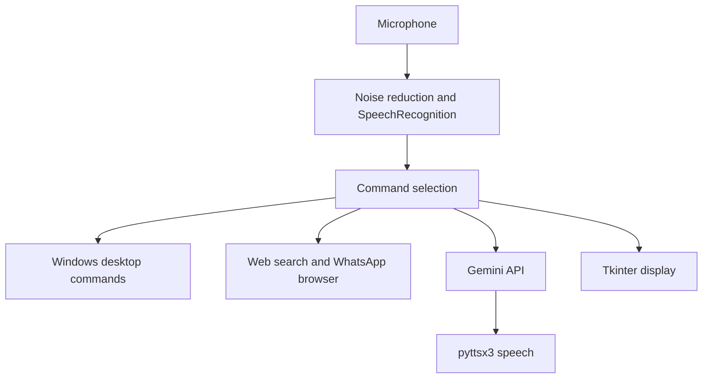

<a id="top"></a>

<div align="center">

# 🤖 Ultron AI

**A Tkinter voice assistant prototype combining speech input, Gemini, and desktop commands.**


[Repository](https://github.com/ashishgiije/ultron-ai) · [Overview](#overview) · [Architecture](#architecture) · [Setup](#setup) · [Validation](#testing-and-validation) · [Audit](AUDIT_REPORT.md)

</div>

## Overview

Ultron is a single-file desktop assistant experiment. Spoken commands select local desktop actions, web searches, or a Gemini response spoken aloud. It is primarily written for Windows and expects local configuration, imagery, audio devices, and browser sessions that are not included in the repository.

## Visual preview

**Screenshot placeholder:** No verified application screenshot is supplied here. Capture the local Tkinter interface after restoring its startup prerequisites. No image is fabricated.

## Key features

- Tkinter interface with start and pause listening controls.
- Speech recognition configured for `en-IN` and noise reduction.
- Gemini conversation and text-to-speech responses.
- Web searches, time reporting, and Windows application shortcuts.
- vCard contact lookup and WhatsApp browser automation.
- AI response export into a local geminiai directory.

## Technology stack

| Technology | Role in this checkout |
|---|---|
| Python + Tkinter | Desktop interface |
| SpeechRecognition + noisereduce + NumPy | Microphone input and audio preprocessing |
| pyttsx3 | Text-to-speech |
| google-generativeai | Gemini conversation |
| pywhatkit + vobject | WhatsApp browser automation and vCard parsing |
| Pillow | GUI image loading |

## Architecture



## Application workflow

Start the GUI → press Start → capture speech → recognize English (India) text → route to a matching command or Gemini → speak and display the response → pause or exit.

## Setup

```bash
git clone https://github.com/ashishgiije/ultron-ai.git
cd ultron-ai
```

Use a Windows graphical desktop with Python, working microphone/speakers, and a browser session where needed. No dependency manifest is supplied. The following matches imports but is not a tested, pinned installation:

```bash
python -m venv .venv
.venv\Scripts\activate
pip install pillow pyttsx3 google-generativeai pywhatkit vobject numpy noisereduce SpeechRecognition pyaudio
```

**Startup prerequisites are missing from the checkout:** `config.py` must provide `apikey` through private local configuration, and `ultron.jpeg` is referenced by the GUI. The file also expects Windows-specific music/contact paths. Do not commit any API key or contact data. After supplying and reviewing these prerequisites, the entry point is `python kapilgui.py`. The configured `gemini-1.5-flash` model’s availability must be checked against your account; no successful model call is claimed.

## Project structure

```text
kapilgui.py # GUI, audio pipeline, command routing, Gemini and local integrations
```

## AI behavior

This is API-backed generation, not a trained model in this repository. A global text transcript is appended to Gemini prompts; each SDK chat session starts with empty structured history. Speech recognition uses Google’s recognition service. No dataset, training procedure, evaluation set, or accuracy metric is supplied. WhatsApp actions require a signed-in browser on the local desktop.

## Testing and validation

Current source review and checks (4 November 2026):

Python source and imports inspected. Full startup was not run: config.py is missing and the application requires a local Windows desktop, audio devices, and private API configuration.

Use the setup commands above and the documented workflow for a local smoke check. No passing automated application suite is claimed where none exists.

## Limitations and roadmap

- Cannot run from a clean checkout without the missing config module.
- Windows command paths and os.startfile are incompatible with a standard Linux server.
- GUI operations are performed from worker threads and need review for Tkinter thread safety.
- Conversation and AI filenames are not bounded or sanitized for robust long-running use.
- Suggested roadmap: external configuration, dependency pins, safe command confirmation, thread-safe UI scheduling, and mocked integration tests.

<details>
<summary>Troubleshooting and contributions</summary>

Check the runtime versions and working directory first. For dependency installation failures, preserve TLS and checksum verification and inspect the first error. For external services, verify your local configuration and account permissions without sharing secret values.

Before contributing, read [the audit](AUDIT_REPORT.md), reproduce the affected behavior, and keep documentation changes separate from application fixes. Add tests for changed behavior and describe remaining limitations accurately.

</details>

## Author

**Ashish Gije** · [GitHub](https://github.com/ashishgiije)

[Back to top](#top)
